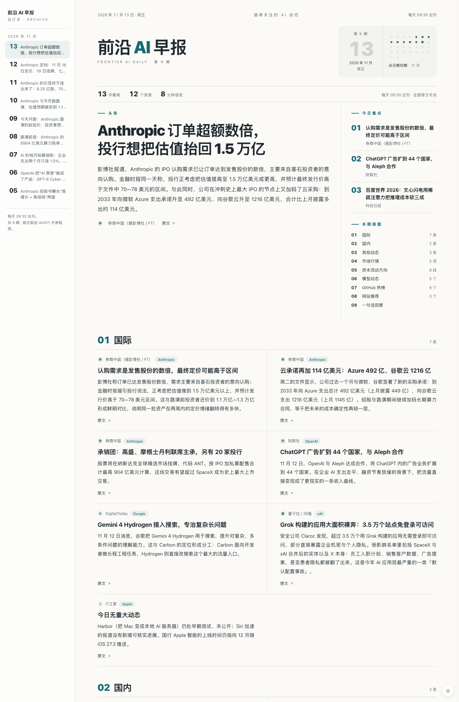

# 前沿 AI 早报 · Skill

把「今天 AI 圈发生了什么」变成一份**报纸版式的单页早报**：采集 → 结构化 JSON → 渲染成可离线打开的 HTML。

版式取自 [AIHOT](https://github.com/javaer2333/AIHOT) 开源框架（MIT）的设计语言：暖白纸面、墨色文字、
一个青色强调、发丝线分隔。渲染器与样式在本仓库内，不依赖 AIHOT 的 Node / PostgreSQL / Docker 服务。



## 特性

- **固定栏目**：头条、国际（Anthropic / OpenAI / Google / xAI / Apple）、国内、其他动态、
  行情（BTC / ETH / SOL / 黄金 / 白银）、资本流动、模型动态、GitHub 热榜、网站推荐、一句话观察。
- **报纸版式**：报头与报眼（期号 + 大号日期点阵 + 当月日历）、数据带、头版双栏、
  每版两栏、上一期 / 下一期、本期完。
- **可点日历**：报眼里每个有刊的日期都能直接点进那一期。
- **单文件产物**：样式内联，无 CDN、无外链资源，离线可读；支持深浅色与打印。
- **多期存档**：新增一期后自动回填历史页的合订本栏、点阵日历和前后期链接。
- **质量闸门**：`check_data.py` 校验结构、原文链接、行情方向、中文简介与资本正文长度。
- **可换行业**：`--site "法律 AI 日报"`、`--edition "每天 08:00 出刊"`、`--css` 换一份样式即可复用。

## 安装

```bash
git clone git@github.com:javaer2333/frontier-ai-daily-skill.git ~/.agents/skills/frontier-ai-daily
# Claude Code 也可以放到 ~/.claude/skills/frontier-ai-daily
```

依赖 Python 3.10+（只用标准库）。`fetch_trending.py` 建议装 `lxml`，没有会自动回退正则。

## 快速开始

```bash
SKILL_DIR=~/.agents/skills/frontier-ai-daily
mkdir -p ai-daily/data ai-daily/reports

# 1) 抓 GitHub 热榜（拿到 repo / stars / today）
python3 "$SKILL_DIR/scripts/fetch_trending.py" --limit 8

# 2) 按 references/data-schema.md 写 data/2026-01-05.json
#    第一次可以先拿示例跑通：
cp "$SKILL_DIR/examples/2026-01-05.json" ai-daily/data/

# 3) 校验 + 渲染
python3 "$SKILL_DIR/scripts/check_data.py" ai-daily/data/2026-01-05.json
python3 "$SKILL_DIR/scripts/render.py" --data ai-daily/data/2026-01-05.json --out ai-daily/reports
```

打开 `ai-daily/reports/2026-01-05.html`。同时生成 `latest.html` 与合订本 `index.html`。

## 目录

```
frontier-ai-daily-skill/
├── SKILL.md                       # 给 Agent 的技能说明与完整工作流
├── scripts/
│   ├── render.py                  # JSON → 报纸版式 HTML（支持 --data/--out/--site/--css）
│   ├── fetch_trending.py          # GitHub Trending 抓取
│   └── check_data.py              # 数据校验
├── styles/aihot.css               # 版式令牌与组件
├── references/
│   ├── data-schema.md             # 字段定义与示例
│   └── collection-playbook.md     # 采集来源、接口、写法与自检清单
├── examples/2026-01-05.json       # 可直接渲染的示例数据
├── tests/test_render.py           # 渲染冒烟测试
└── assets/preview.png
```

## 渲染参数

```bash
python3 scripts/render.py --data data/2026-01-05.json --out reports \
  --site "前沿 AI 早报" --motto "值得关注的 AI 动态" --edition "每天 09:30 出刊" \
  --no-history     # 只渲染当期
  --index          # 只重建合订本
  --css path.css   # 换样式
```

默认：`--out` 为数据文件同级的 `reports/`；存档目录为数据文件所在目录；
样式自动查找 `styles/aihot.css`（脚本目录的上一级）。

## 挂定时任务

在 DSH 里可以直接用自然语言建日程，提示词示例：

```text
生成今日「前沿 AI 早报」。项目目录：<项目路径>/ai-daily
读 <技能目录>/SKILL.md，按工作流采集、写 data/YYYY-MM-DD.json，
跑 check_data.py 与 render.py，最后 present reports/YYYY-MM-DD.html；
聊天里只给精简版（头条、行情表、GitHub 前 3、网站推荐、一句话观察）。
```

## 测试

```bash
python3 -m unittest discover -s tests -v
```

## 许可与致谢

- 本仓库代码：MIT（见 [LICENSE](LICENSE)）。
- 版式语言来自 [AIHOT](https://github.com/javaer2333/AIHOT)，MIT，Copyright © 2026 数字生命卡兹克；
  再分发请保留 [NOTICE](NOTICE)。**不要使用 AIHOT 的名字和 Logo**——换成你自己的站名。
